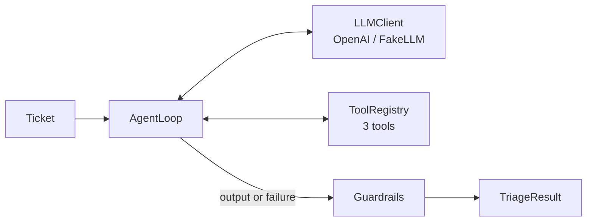

# Support Ticket Triage Agent

AI agent that triages customer support tickets. **The LLM decides; deterministic code enforces policy.**
Plain Python 3.11+, `openai` SDK, Pydantic v2, `rich`. No agent framework.

## Requirements → where

| Requirement | Implementation |
|---|---|
| 1. Classify urgency | `urgency`: critical / high / medium / low |
| 2. Extract key info | `product`, `issue_type`, `sentiment` + `sentiment_trend`, `language`, `intents[]` |
| 3. Search a knowledge base | `search_knowledge_base`: BM25 over bilingual EN/TH `kb.json`; cited ids are verified |
| 4. Decide next action | `action` (auto_respond / route_to_specialist / escalate_to_human) + `target_team` + draft reply |
| 5. At least 2 tools | 3 tools: `get_customer_history`, `search_knowledge_base`, `check_system_status` |
| System prompt | [`triage/prompts/system_prompt.md`](triage/prompts/system_prompt.md) |
| Tool definitions | [`triage/tools/`](triage/tools/): Pydantic args → strict JSON schema + handler (mocked data) |
| Write-up | [`WRITEUP.md`](WRITEUP.md) |

## Quickstart

```bash
git clone https://github.com/Settaawut/AI_Support_Ticket_Agent_Ten.git
cd AI_Support_Ticket_Agent_Ten
```

**macOS / Linux**
```bash
python3 -m venv .venv && source .venv/bin/activate
pip install -e ".[dev]"
python -m triage run --all --offline        # scripted FakeLLM, no API key
export OPENAI_API_KEY=sk-...                # never commit keys
python -m triage run --all                  # real model
```

**Windows (PowerShell)**
```powershell
py -3.12 -m venv .venv
Set-ExecutionPolicy -Scope Process -ExecutionPolicy Bypass
.venv\Scripts\Activate.ps1
pip install -e ".[dev]"
python -m triage run --all --offline
$env:OPENAI_API_KEY = "sk-..."
python -m triage run --all
```

| Command / flag | Purpose |
|---|---|
| `run --all` | The 3 sample tickets |
| `run --ticket file.json` | Your own ticket(s), same schema as `triage/data/sample_tickets.json` |
| `--offline` / `--json` / `--verbose` | FakeLLM / JSON output / per-ticket trace |
| `python -m eval.run_eval [--offline]` | Labelled eval set + metrics |
| `make check` | ruff + mypy --strict + 131 pytest tests (Windows: run `ruff`, `mypy`, `pytest` directly) |

Env vars: `OPENAI_MODEL` (default `gpt-4o-mini`), `TRIAGE_CONFIDENCE_THRESHOLD` (0.6), `TRIAGE_MAX_ITERATIONS` (6),
`TRIAGE_LLM_TIMEOUT_S` (30), `TRIAGE_TEMPERATURE` (0; `none` for reasoning models). See `.env.example`.

## Results on the sample tickets

| Ticket | Urgency | Action → team | Why |
|---|---|---|---|
| **T-1001** failed upgrade | high | escalate → billing | 3 × $29.99 in history, no active plan, chargeback threat, 2 h deadline, escalating anger. No refund/timeline promised. |
| **T-1002** Enterprise, TH | critical | escalate → incident_response | Status page says *operational*, internal feed has an Asia sev1 (`status_conflict: true`). Reply in Thai. |
| **T-1003** dark mode | low | route → product_engineering | 4 intents: plan question answered from KB; 2 bugs + 1 feature request routed. No over-escalation. |

Guardrails catching a wrong model: `python -m triage run --ticket eval/wrong_ai_demo.json --offline`.
Failure paths (empty ticket, injection, broken output, tool error): `eval/edge_cases_demo.json`.

## Architecture



1. **Agent loop** (`agent/loop.py`): tool calling + strict JSON-schema output, validated by Pydantic. Invalid → one repair retry. Timeouts, backoff retries, iteration cap. Never raises.
2. **Fallback** (`agent/fallback.py`): any failure → escalate_to_human with a holding reply and a logged reason.
3. **Guardrails** (`guardrails/`): ordered pure rules; can only **raise** action/urgency. Every change is recorded in `guardrail_overrides`.

| Guardrail | Effect |
|---|---|
| `billing_dispute_never_auto` | Chargeback wording or ≥ 2 unresolved payments → escalate, billing |
| `enterprise_outage_escalate` | Enterprise + outage → escalate, critical |
| `security_escalate` / `legal_threat_escalate` | → escalate, ≥ high |
| `prompt_injection_escalate` | → escalate, draft discarded |
| `no_unsafe_promises` | Refund / ETA / compensation in draft → holding reply |
| `draft_language_matches` | Wrong-language draft → replaced |
| `unverified_citations` / `ungrounded_auto_respond` | Unretrieved KB ids removed; uncited auto-reply → route |
| `low_confidence_escalate` / `action_matches_intents` | Confidence < threshold → escalate; action ≥ most cautious intent |

**Safety:** ticket text is delimited as data; PII stripped before the LLM and masked in `logs/triage.jsonl`; no secrets in the repo.

## Extending

- **Tool:** one file in `triage/tools/` (args model + handler + `Tool(...)`), one line in `tools/registry.py`. Schema, validation, errors and tracing are automatic.
- **Guardrail:** one `(output, ctx) -> Fix | None` function in `guardrails/rules.py`, one line in `guardrails/registry.py`, one row in the test table.
- **LLM provider:** implement `LLMClient.complete()` (`llm/base.py`).

## Testing and evaluation

- **131 tests**, all offline, < 2 s: tools, BM25, every guardrail + the "never lowers" invariant, parsing/repair, agent loop failures, retries, OpenAI adapter, injection, PII masking, CLI.
- **Eval** (`eval/dataset.jsonl`, 12 tickets incl. Japanese, spam, security, empty, injection): urgency/action accuracy and **escalation recall** (headline; exits 1 on a miss).
- `--offline` replays scripted model replies: it tests everything *around* the model, not model quality.

## Project structure

```
triage/  agent/ llm/ tools/ guardrails/ models/ prompts/ observability/ data/  cli.py config.py
eval/    dataset.jsonl  run_eval.py  metrics.py
tests/   one file per component
```

## Known limitations

- Keyword signals are a safety net, not NLU; paraphrases can slip past.
- Language detection is script-based (Thai / Latin / other).
- BM25 with Thai bigrams suits a small FAQ; a real KB needs embeddings + reranking.
- Guardrails guarantee minimum action/urgency, not the exact team. All data is mocked.
