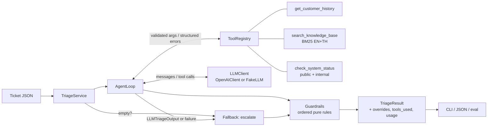

# Support Ticket Triage Agent

An AI agent that triages customer support tickets. For each ticket it:

1. **Classifies urgency** (critical / high / medium / low).
2. **Extracts** product, issue type, sentiment *and its trend*, language, and every separate intent.
3. **Searches a knowledge base** (bilingual English/Thai BM25) and cites the articles it uses.
4. **Decides the next action** (`auto_respond`, `route_to_specialist` or `escalate_to_human`) and the team.
5. **Uses 3 tools**: `get_customer_history`, `search_knowledge_base`, `check_system_status`.

It also drafts a reply in the customer's language. The core idea: **the LLM decides, and deterministic
code enforces the rules.** Guardrails run after the model and can only make a decision *more* cautious.

Built with plain Python 3.11+, the `openai` SDK, Pydantic v2 and `rich`. No agent framework.

---

## Quickstart

```bash
python -m venv .venv && source .venv/bin/activate      # Windows: .venv\Scripts\activate
pip install -e ".[dev]"                                 # or: make install

# Offline: no API key needed (scripted FakeLLM, see "Offline mode" below)
python -m triage run --all --offline

# Real model
export OPENAI_API_KEY=sk-...          # never commit keys; .env.example lists every variable
export OPENAI_MODEL=gpt-4o-mini       # optional, this is the default
python -m triage run --all
```

### Commands

| Command | What it does |
|---|---|
| `python -m triage run --all` | Triage the 3 bundled sample tickets (the default source) |
| `python -m triage run --ticket path.json` | Triage one ticket (or a JSON list) from a file |
| `... --offline` | Use the scripted `FakeLLM` instead of OpenAI |
| `... --json` | Print machine-readable results (pipe into `jq`) |
| `... --verbose` | Also show the per-ticket trace (LLM calls, tool calls, guardrails) |
| `python -m eval.run_eval [--offline]` | Run the labelled eval set and print metrics |
| `make test` / `make lint` / `make typecheck` / `make check` | pytest / ruff / mypy (strict) / all three |

A ticket file looks like `triage/data/sample_tickets.json`:
`{"id", "customer": {"id", "plan", "region", "seats", "tenure_months", "notes"}, "messages": [{"age", "text"}]}`.

Structured JSON logs are written to `logs/triage.jsonl`, with emails and card numbers masked.

### Configuration (environment variables)

| Variable | Default | Meaning |
|---|---|---|
| `OPENAI_API_KEY` | *(required online)* | Read by the OpenAI SDK |
| `OPENAI_MODEL` | `gpt-4o-mini` | Any chat model that supports tools + structured outputs |
| `TRIAGE_TEMPERATURE` | `0` | Set to `none` for reasoning models that reject `temperature` |
| `TRIAGE_MAX_ITERATIONS` | `6` | Cap on LLM turns per ticket |
| `TRIAGE_CONFIDENCE_THRESHOLD` | `0.6` | Below this the ticket is escalated to a human |
| `TRIAGE_LLM_TIMEOUT_S` | `30` | Per-request timeout (3 retries with exponential backoff) |
| `TRIAGE_LOG_LEVEL` | `INFO` | Log level for `logs/triage.jsonl` |

---

## Results on the sample tickets

Offline, with the scripted model (`python -m triage run --all --offline`):

| Ticket | Urgency | Action → team | Key evidence |
|---|---|---|---|
| **T-1001** Free plan, failed upgrade | **high** | escalate_to_human → billing | History shows 3 × $29.99 attempts and no active subscription; anger is escalating; chargeback threat; deadline in 2 hours. The draft explains authorization holds (KB-BILL-002) and promises **no** refund or timeline. |
| **T-1002** Enterprise, Thailand | **critical** | escalate_to_human → incident_response | `check_system_status(asia)`: the public page says *operational*, but the internal feed has an active sev1 with HTTP 500s (`status_conflict: true`). The reply is in **Thai** and does not reveal the incident ID. |
| **T-1003** Pro, dark mode | **low** | route_to_specialist → product_engineering | 4 intents: the plan question is answered from the KB (dark mode is not Pro-only); the missing *Dark* option and *System Default* ignoring macOS are routed as bugs; scheduled dark mode is logged as a feature request. No over-escalation. |

What happens when the **model is wrong** is tested too (`tests/test_service.py`):

- **T-1001, model says "low, auto_respond, we'll refund all three charges".** Guardrails turn this into high / escalate_to_human with a safe holding reply. The invented citation is also removed.
- **T-1002, model says "medium, clear your browser cache", in English.** Guardrails turn this into critical / escalate_to_human / incident_response, and the reply is replaced with a Thai holding reply.
- **The LLM is down.** The ticket falls back to escalate_to_human, and T-1002 is still marked critical.

<details><summary>Example CLI output (T-1003, trimmed)</summary>

```
╭──────────────────────────────── T-1003 ────────────────────────────────╮
│ Urgency     LOW                                                        │
│ Action      route_to_specialist                                        │
│ Team        product_engineering                                        │
│ Issue       bug | Desktop app (macOS) / Appearance settings            │
│ Sentiment   positive (stable)                                          │
│ Tools used  get_customer_history, search_knowledge_base                │
│ KB cited    KB-UI-001, KB-UI-002, KB-FR-001                            │
│ Intents                                                                │
│  Is dark mode limited by plan?        how_to           auto_respond    │
│  'Dark' option missing on 4.3.0       bug              route → eng     │
│  'System Default' ignores macOS       bug              route → eng     │
│  Schedule dark mode at 6pm            feature_request  route → eng     │
│ ╭─ Draft response ───────────────────────────────────────────────────╮ │
│ │ Thanks for the detailed notes, and you're not missing anything:    │ │
│ │ dark mode isn't a Pro-only feature. From app version 4.2 ...       │ │
│ ╰────────────────────────────────────────────────────────────────────╯ │
│ 2 LLM calls | 0+0 tokens | ~$0.00000 | 3 ms                            │
╰────────────────────────────────────────────────────────────────────────╯
```
</details>

---

## Architecture



Pipeline for one ticket (`triage/agent/service.py`):

1. **Input guard.** An empty ticket goes straight to a safe fallback, and no tokens are spent.
2. **Agent loop** (`agent/loop.py`). It uses OpenAI tool calling plus a strict JSON-schema response format. Tool results go back to the model. The final message is validated by Pydantic. If it's invalid, the error is fed back **once**; if it's still invalid, or the iteration cap is hit, or the LLM is down, the loop returns a *failure reason*. It never raises.
3. **Fallback** (`agent/fallback.py`). Escalate to a human with a holding reply in the customer's language. Fail safe, never silent: `fallback_reason` is set on the result.
4. **Guardrails** (`guardrails/`). Ordered pure functions that each return a `Fix` or `None`. The engine applies fixes, records a `GuardrailOverride` per changed field, and **rejects any rule that lowers action or urgency**.
5. **Result.** `TriageResult` = the model's output plus fields only code can set (`tools_used`, `guardrail_overrides`, `fallback_reason`, `usage`).

### Guardrails

| Rule | Fires when | Effect |
|---|---|---|
| `unverified_citations` | A KB id was cited that no search returned in this run | The id is removed |
| `no_unsafe_promises` | The draft promises a refund, ETA, compensation or guarantee (EN/TH patterns) | Holding reply; `auto_respond` → escalate |
| `draft_language_matches` | The draft's script ≠ the customer's language (detected from the ticket, not the model) | Holding reply in the right language; ≥ route |
| `ungrounded_auto_respond` | `auto_respond` with no verified KB citation | → route_to_specialist |
| `billing_dispute_never_auto` | Billing + (chargeback/dispute wording **or** ≥2 unresolved payments in history) | escalate, ≥ high, billing |
| `enterprise_outage_escalate` | Enterprise plan + outage (model label or EN/TH text signal) | escalate, critical, incident_response |
| `security_escalate` / `legal_threat_escalate` | Breach/hacked/… or lawyer/GDPR/… wording | escalate, ≥ high |
| `prompt_injection_escalate` | "ignore previous instructions", "you are now", … | escalate + holding reply |
| `low_confidence_escalate` | confidence < threshold | escalate |
| `action_matches_intents` | Some intent is more cautious than the ticket-level action | Raise the ticket-level action |

The guardrails never depend on which tools the model chose to call. If the model skipped `get_customer_history`, the service fetches it for the guardrails (`guardrail_lookup` in the trace).

### Safety

- **Prompt injection.** Ticket text is rendered inside `<ticket_data>` tags, and customer text can't close the block. The prompt says the content is data, not instructions, and a guardrail escalates injection attempts and discards the draft.
- **No hallucinated answers.** Drafts must cite KB ids, and the citations are checked against what was actually retrieved. Search returns an explicit "no result, do not invent".
- **No unauthorised promises.** Refunds, ETAs and compensation are human decisions (`no_unsafe_promises`).
- **PII.** The customer tool strips name and email before data reaches the model, and logs mask emails and card numbers. The repo contains no secrets; there is only `.env.example`.

---

## Extending it

**Add a tool (one new file + one line):**

1. Create `triage/tools/my_tool.py` with a Pydantic args model, a handler, and a `Tool`:
   ```python
   class LookupOrderArgs(BaseModel):
       order_id: str = Field(description="Order id from the ticket")

   def lookup_order(args: LookupOrderArgs) -> dict[str, Any]:
       ...  # raise ToolError("not found") for expected failures

   ORDER_TOOL = Tool("lookup_order", "When to use it ...", LookupOrderArgs, lookup_order)
   ```
2. Add `ORDER_TOOL` to `default_registry()` in `triage/tools/registry.py`.

The strict JSON schema, argument validation, error handling and tracing come for free.

**Add a guardrail (one function + one line):**

1. Write a pure function in `triage/guardrails/rules.py`:
   ```python
   def vip_never_auto(out: LLMTriageOutput, ctx: GuardrailContext) -> Fix | None:
       if "vip" not in ctx.ticket.customer.notes.lower():
           return None
       return require(out, "VIP account", action=Action.ROUTE_TO_SPECIALIST,
                      team=Team.ACCOUNT_MANAGEMENT)
   ```
2. Append it to `DEFAULT_RULES` in `triage/guardrails/registry.py`. Add a row to the table in `tests/test_guardrails.py`; the "never lowers severity" invariant test then covers it automatically.

**Swap the LLM provider:** implement `LLMClient.complete()` (`triage/llm/base.py`) and pass a factory to `TriageService`.

---

## Testing and evaluation

```bash
make check                       # ruff + mypy --strict + 129 pytest tests, all offline, < 2 s
python -m eval.run_eval --offline
python -m eval.run_eval          # real model; exits 1 if any escalation is missed (CI gate)
```

The tests cover:
- tools and BM25 ranking (EN + TH)
- every guardrail, table-driven, plus the ratchet invariant
- output parsing and the repair path
- the agent loop (tool errors, iteration cap, malformed output, LLM outage, repeated-call cache)
- retry/backoff
- the OpenAI adapter, with the SDK stubbed
- prompt injection
- PII masking
- a CLI smoke test

The eval set (`eval/dataset.jsonl`) has the 3 samples plus 9 edge cases: vague one-liner, angry-but-trivial, Japanese, spam, security incident, empty message, prompt injection, mixed billing + export, and a simple how-to. It reports urgency accuracy, action accuracy, **escalation recall** (the headline metric: a missed escalation is the expensive error), escalation precision, and per-ticket diffs. A JSON report is written to `eval/reports/`.

### Offline mode, honestly

`--offline` replays hand-written scripts (`triage/data/fake_scripts/<ticket_id>.json`). It exercises everything *around* the model deterministically: tool execution, parsing, fallbacks and guardrails. It says **nothing about real model quality**. Some scripts deliberately make mistakes (under-escalating a security incident, obeying an injection, low confidence) to show the guardrails and metrics working. Tickets without a script get an "unsure model" default, which the guardrails escalate. Run the eval without `--offline` to measure the real model.

---

## Project structure

```
triage/
  agent/          service.py (pipeline) · loop.py (tool-calling loop) · parsing.py · fallback.py
  llm/            base.py (LLMClient protocol) · openai_client.py · fake.py · retry.py
  tools/          base.py (Tool) · registry.py · customer_history.py · knowledge_base.py · bm25.py · system_status.py
  guardrails/     base.py (engine, Fix, require) · rules.py · registry.py · signals.py (EN/TH lexicons) · templates.py
  models/         enums.py · ticket.py · result.py · schema.py (Pydantic -> strict JSON schema)
  prompts/        system_prompt.md · __init__.py (loader, ticket rendering)
  observability/  trace.py (per-ticket trace, cost) · logging.py (JSON logs, PII masking)
  data/           sample_tickets.json · kb.json · customers.json · incidents.json · fake_scripts/
  config.py · cli.py · render.py · __main__.py
eval/             dataset.jsonl · metrics.py · run_eval.py · reports/
tests/            one file per component
WRITEUP.md        one-page design write-up
```

## Design decisions

- **LLM decides, code enforces.** The model handles nuance (tone, trajectory, intents). Business policy (money, outages, security, promises) lives in tested deterministic rules, because those must hold whatever the model says.
- **Two schemas.** The model fills `LLMTriageOutput`, which is sent as a strict JSON schema generated from Pydantic. `TriageResult` adds audit fields only code can set.
- **Tool schemas generated from Pydantic.** The schema shown to the model and the validator can't drift apart.
- **Prompt as a file.** `system_prompt.md` can be reviewed and A/B tested without touching code.
- **No framework.** The loop is one ~140-line file with nothing hidden, so it's easy to debug, test and port.
- **Retries are explicit.** The SDK's built-in retries are off; `with_retry` retries only transient errors, with backoff and jitter, and logs them.

## Known limitations

- Keyword signals (chargeback, outage, security, injection, promises) are a safety net, not NLU. Paraphrases can slip past them. That is why they back up the model rather than replace it.
- Language detection is script-based (Thai / Latin / other), so it can't tell English from Spanish.
- The BM25 search uses Thai character bigrams instead of a word segmenter. That works for a small FAQ, but a real KB would need embeddings plus a reranker.
- Guardrails guarantee minimum *action* and *urgency*, not the exact team. A model that escalates to the wrong team keeps that team.
- All data is mocked, and `age` is a relative string rather than a timestamp.
- The real-model path is tested against a stubbed SDK, not against the live API.
